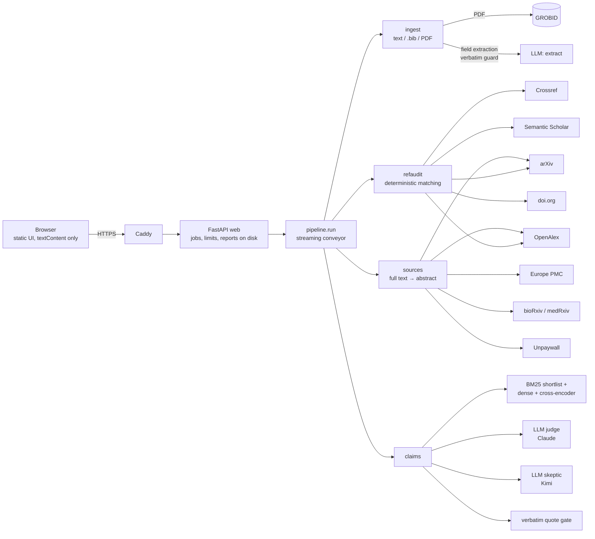

# ClaimTrace

Citation audit for scientific manuscripts. For every reference ClaimTrace checks that it **exists
and is described correctly**; for every citing sentence it checks that the **cited source actually
says it** — and shows a **verbatim quote** from the source as evidence.

Built from scratch during HackGlobal 2026. A trial prototype from November 12 was **not** used.

## What it does

Paste a manuscript (or upload `.txt` / `.md` / `.bib` / `.pdf`) and get a report:

- **References** — `verified`, `metadata_mismatch` (title / authors / year / DOI differ, with
  cited → found), `retracted`, `not_found`, or `unchecked` (a lookup failed or nothing could be
  compared — never presented as "fake").
- **Claims** — `supported`, `partly_supported`, `unsupported` (only with a ≥ 5-word quote found
  verbatim in the source), `insufficient_evidence`, or `source_not_found`; `needs review` when the
  two independent models disagree; "checked against the abstract only" vs "full text".
- A shareable link to the report (kept for the newest 1000 reports), JSON / Markdown export and a
  chat that answers only from the report.

Design rules that are the product (see `AGENTS.md`): a failure is never a negative finding;
existence and metadata are decided by deterministic code, not by an LLM; no verdict without a
verbatim quote; judge and skeptic run on different providers.

## Run it

Requirements: Docker (8 GB RAM for the full stack), API keys for Anthropic and Moonshot, an
OpenAlex key, a contact e-mail.

```bash
cp .env.example .env            # fill in keys, models, CONTACT_EMAIL, DOMAIN
DOMAIN=localhost docker compose up -d --build
scripts/smoke.sh https://localhost   # SMOKE_INSECURE=1 for the local Caddy CA
```

Open `https://localhost` (or your `DOMAIN`). Server deployment step by step: `docs/DEPLOY.md`.

Development: `uv sync`, then `uv run ruff check . && uv run pytest -q` (offline; live tests with
`RUN_LIVE=1`). Evaluation: `uv run python -m eval.run --suite scifact|refs|retrieval` (see
`eval/README.md`).

## Architecture



Modules (`ingest`, `refaudit`, `sources`, `claims`) never import each other; only the pipeline
connects them. All outbound HTTP goes through one client with an SSRF guard (public IPs only,
every redirect hop), an OpenAlex disk cache and a paid-search budget. Contracts:
`docs/ARCHITECTURE.md`.

## Evaluation (honest numbers)

All numbers are from `eval/results/` (commit them with the code that produced them). Models:
judge `claude-sonnet-5-5`, skeptic `kimi-k3.1-pro-highspeed`.

**References** — 399 real seed references (393 + 6 retracted; medicine, CS, physics, social
science, economics, biology), with deterministic injected errors; 1728 cases.

| mutation | n | correct |
|---|---|---|
| unchanged ⇒ verified | 393 | 97.7% (misses: consortium authors ⇒ false alarm `metadata_mismatch`) |
| year + 3 ⇒ metadata_mismatch | 393 | 100% |
| negated title ⇒ metadata_mismatch | 393 | 100% |
| swapped first author ⇒ metadata_mismatch | 393 | 100% |
| fabricated ⇒ not_found | 150 | 55.3% (the rest `unchecked`: Crossref failures under load — safe, never `verified`) |
| retracted ⇒ retracted | 6 | 100% |
| **false `verified`** | 1728 | **0** |
| **false `not_found`** (a real paper called non-existent) | 1578 | **0** |

**Claims — SciFact dev** (claims against their cited abstracts, n = 100, seed 0):

| variant | accuracy | false-supported rate | supported precision | supported recall |
|---|---|---|---|---|
| one model (judge only) | 0.870 | 0.167 | 0.787 | 0.925 |
| judge + skeptic | 0.900 | 0.100 | 0.857 | 0.900 |
| judge + skeptic + quote gate (product) | 0.900 | 0.100 | 0.857 | 0.900 |

The quote gate changes nothing on SciFact because abstracts are short and every positive verdict
already quotes verbatim; its job is full texts and invented quotes (unit + adversarial tests).

**Retrieval** — evidence recall@6 for SciFact claims against a 23.5k+ character haystack (gold
abstract + 20 distractor abstracts), n = 209, no LLM:

| retrieval | recall@6 | MRR | latency / claim |
|---|---|---|---|
| BM25 | 0.938 | 0.747 | 3 ms |
| hybrid (BM25 shortlist + bge-small dense) | 0.976 | 0.798 | 2.3 s (CPU) |
| hybrid + cross-encoder rerank (product) | 0.990 | 0.852 | 2.7 s (CPU) |

Verdicts on the same haystacks (LLM judge + skeptic + quote gate, n = 60, seed 0):

| retrieval | accuracy | false-supported rate | supported precision | supported recall | quote verified |
|---|---|---|---|---|---|
| hybrid | 0.850 | 0.167 | 0.778 | 0.875 | 0.80 |
| hybrid + rerank (product) | 0.883 | 0.139 | 0.815 | 0.917 | 0.85 |

Small sample (60): read the direction, not the decimals.

**Speed** (cold caches, full Docker stack, same models; one run each — LLM latency varies a lot
between runs, so read the order of magnitude):

| document | time to first result: before → after | full time: before → after |
|---|---|---|
| "Attention Is All You Need" PDF, 40 refs / 58 claims | 533 s (report only at the end) → **9 s** | 533 s → **292 s** |
| same, second run (providers 2–3× slower that hour) | — → 3.3 s | — → 352 s |
| same, final config (skeptic `kimi-k2.7-code-highspeed`, 16 skeptic slots) | — → 5.3 s | — → 317 s |
| same paper as text (eval `timing`, no GROBID) | — → 25 s | — → 141 s |
| review with 204 refs (PMC9820749), references only | — → 35 s | audit of 200 refs: 45.5 s (claims not run: LLM budget) |
| built-in sample | ~20 s → **instant** (saved example; "Run live" ~20 s) | — |

**Speed is closed and the 3-minute target was NOT reached** (best full run 292 s, final config
317 s). After the faster skeptic (7.4 s per call instead of 15.7 s) the bottleneck moved to
retrieval on CPU inside the container: 50 retrievals × ~12 s each, at most 2 at a time (bounded
for memory; app peak 1.39 GB of the 1.5 GB cap). A 200-reference document's first result is 35 s
(reference-field extraction), measured before chunked streaming of the reference list landed.
A last no-LLM pass (length-sorted small batches) then cut container retrieval for the same 50
retrievals from 264 s to 103 s (4 threads × 2) at half the memory; the end-to-end effect on the
PDF was **not re-measured live**.

## Experiments that were measured and rejected

| experiment | result | why rejected |
|---|---|---|
| Faster skeptic `kimi-k2.7-code-highspeed` | SciFact n=100: 0.91 acc / 0.083 false-supported (base 0.90 / 0.10); live PDF 317 s vs 292 s | no full-time gain; more `unsupported` on method citations (7 vs 2–4) |
| Several claims per model call (batching) | 61 claims ×2 runs: acc 0.885 vs 0.902–0.918, one more false supported | accuracy never better |
| Section-aware passages | retrieval recall@6 0.990 → 0.971, MRR 0.852 → 0.834 | worse retrieval (section *label* kept) |
| Number-in-quote cap | SciFact: no metric changed (5/100 claims have numbers) | no measurable gain |
| Fast PDF parser for sources (default) | live: 7 claims without a source vs 0 | coverage regression; kept opt-in |

## Limitations

- Claims are judged by LLMs; a verbatim quote proves the words exist in the source, not that the
  model read them correctly. Disagreement between judge and skeptic is flagged, not resolved.
- Citations of methods or datasets ("we use X [12]") often come out `partly_supported`.
- Only open-access full text is used; otherwise the claim is checked against the abstract and
  labelled so. Some publishers / bioRxiv block automated downloads.
- Group / consortium authors produce false `metadata_mismatch` alarms; venue is not compared (the
  report lists which fields were checked).
- A DOI registered outside Crossref/OpenAlex (e.g. Zenodo) is not compared ⇒ `unchecked`.
- Superscript numeric citations and `(1, 2)`-style markers are not detected.
- Prompt-injection resistance relies on tagged untrusted text plus an independent skeptic; it is
  tested for wrapping, not with a live adversarial set.

## How we used Vultr

ClaimTrace is designed to run on a single **Vultr Cloud Compute** instance (8 GB RAM, Ubuntu
24.04) with Docker Compose: `app` + `grobid` + `caddy` (automatic HTTPS, e.g. via sslip.io).
Reports, the OpenAlex cache and the paid-search counter live in a Docker volume that survives
restarts and updates. Step-by-step and verification status per step: `docs/DEPLOY.md`.
*Status: not yet deployed — waiting for credits.*

## AI assistance

Built with Claude Code as the lead engineer coordinating sub-agents: developers implemented
modules in separate git worktrees and opened PRs; adversarial "tester" agents tried to make the
system produce confident wrong answers and pinned each bug as a failing test; the lead reviewed,
re-ran lint/tests and merged. An independent review (Codex) was checked finding by finding
(`docs/DECISIONS.md`). The human set direction, chose models and priorities, and holds the keys.
At runtime the product uses Claude (judge, extraction) and Kimi (skeptic).

Design tooling (installed locally into `.claude/skills/`, not committed; read as design guidance
only — no third-party hooks, scripts or network fetches were run): `design-brief`,
`design-tokens`, `design-review` (julianoczkowski/designer-skills), `ui-ux-pro-max`
(nextlevelbuilder), `design-taste-frontend` (leonxlnx/taste-skill; its auto-run Stop hook was
removed from the local copy), `emil-design-eng` (emilkowalski/skills), `web-design-guidelines`
(vercel-labs; its rules are fetched from the network at use time, so it was not used offline),
Impeccable (installed with `--no-hooks`).
