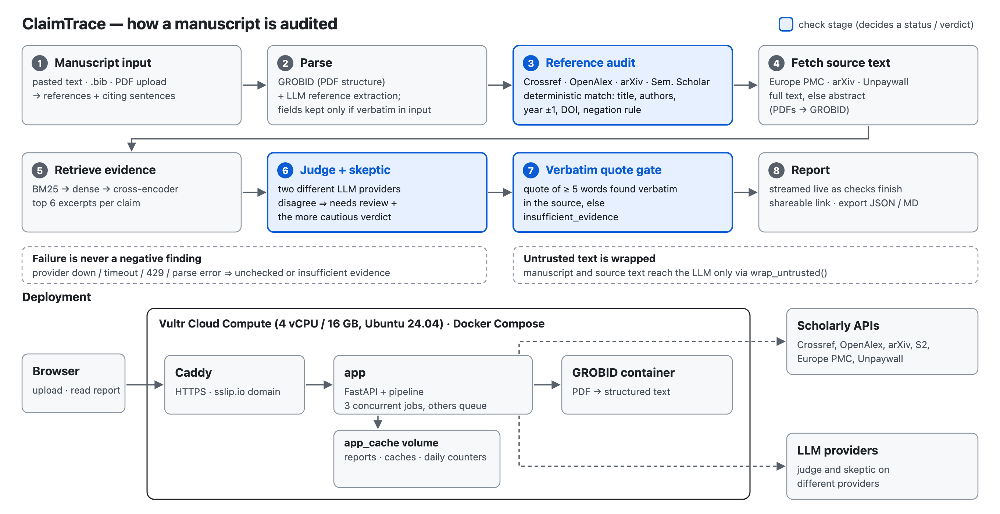

# ClaimTrace

**Does each cited source actually say what the sentence citing it claims?** ClaimTrace audits the
citations in a scientific manuscript: for every reference it checks that the work **exists and is
described correctly**, and for every citing sentence it checks the **cited source itself** and
shows a **verbatim quote** from it as evidence, or says plainly that it could not check.

**Live:** https://66-135-11-202.sslip.io (Vultr Cloud Compute)

Built from scratch during HackGlobal 2026 by Izbassar Orynbassar and Madina Sissenbay.

## Who it is for

- **Authors** before submission: catch a wrong year, a mangled title, a reference that does not
  exist, or a sentence that overstates what the cited paper found.
- **Reviewers and editors**: see in one screen which citations need a human look, with the source
  quote next to the claim.
- **Anyone reading AI-assisted writing**: fabricated or misattributed references are flagged
  without trusting a language model for the existence check.

## Check it in one minute

1. Open https://66-135-11-202.sslip.io and press **Try a sample**. A saved report of a short
   manuscript appears at once: one invented reference is `not found`, one overstated sentence is
   `not supported`, one claim is `supported` with its quote.
2. Click a row to expand it: the full citing sentence, the source quote, one line of reason and a
   link to the source; **Details** shows what the judge and the skeptic said.
3. Press **Run live** to run the same sample through the real pipeline (about 20 s), or paste your
   own text / upload a PDF. Results stream in as they are checked; the link is shareable.

Best used on published or preprint papers; do not upload confidential manuscripts (see "About your
data" on the home page: reports are kept for the newest 1000 audits and visible to anyone with the
link; uploaded files are not kept).

## What it reports

- **References**: `verified`, `metadata_mismatch` (title / authors / year / DOI differ, shown as
  cited → found), `retracted`, `not_found`, or `unchecked` (a lookup failed or nothing could be
  compared; never presented as "fake").
- **Claims**: `supported`, `partly_supported`, `unsupported` (each only with a ≥ 5-word quote
  found verbatim in the source), `insufficient_evidence`, or `source_not_found`; **needs review**
  when the two models disagree; **judge only** when one model was unavailable; "abstract only"
  vs "full text".
- The report opens with what needs attention first; JSON / Markdown export and a chat that answers
  only from the report.

The rules that are the product (`AGENTS.md`): a failure is never a negative finding; existence and
metadata are decided by deterministic code, not by an LLM; no verdict without a verbatim quote;
judge and skeptic run on different providers.

## Architecture



A streaming conveyor (`claimtrace/pipeline.py`): references are audited and their sources fetched
one by one while claims are checked, so the first results appear in seconds. Modules (`ingest`,
`refaudit`, `sources`, `claims`) never import each other. All outbound HTTP goes through one client
with an SSRF guard (public IPs only, every redirect hop), disk caches and a paid-search budget.
Contracts: `docs/ARCHITECTURE.md`.

## Evaluation (method and honest numbers)

All numbers come from `eval/results/` and can be reproduced with `uv run python -m eval.run
--suite <name>` (`eval/README.md`). Models: judge `claude-sonnet-5-5` (Anthropic), skeptic
`kimi-k3.1-pro-highspeed` (Moonshot).

**References.** Method: 399 real seed references (393 + 6 retracted; medicine, CS, physics,
social science, economics, biology), each also mutated deterministically (year + 3, negated title,
swapped first author, fully fabricated): 1728 cases, decided against Crossref / OpenAlex / arXiv /
Semantic Scholar / doi.org.

| case | n | correct |
|---|---|---|
| unchanged ⇒ verified | 393 | 97.7% (misses: consortium authors ⇒ false alarm `metadata_mismatch`) |
| year + 3 ⇒ metadata_mismatch | 393 | 100% |
| negated title ⇒ metadata_mismatch | 393 | 100% |
| swapped first author ⇒ metadata_mismatch | 393 | 100% |
| fabricated ⇒ not_found | 150 | 55.3% (the rest `unchecked`: Crossref failures under load; never `verified`) |
| retracted ⇒ retracted | 6 | 100% |
| **false `verified`** | 1728 | **0** |
| **false `not_found`** (a real paper called non-existent) | 1578 | **0** |

This full run predates two fixes made after deployment, when real ML papers with venue-glued
titles and unindexed technical reports came back `not_found` (venue stripping for search only, an
arXiv title fallback, a grey-literature rule). After them a 50-case re-run gave accuracy 1.0,
0 false `verified`, 0 false `not_found`, all 10 fabricated still `not_found`; the full 1728-case
run was not repeated (paid-search budget).

**Claims (SciFact dev).** Method: claims checked against their cited abstracts with SciFact's
gold labels, n = 100, seed 0.

| variant | accuracy | false-supported rate | supported precision | supported recall |
|---|---|---|---|---|
| one model (judge only) | 0.870 | 0.167 | 0.787 | 0.925 |
| judge + skeptic | 0.900 | 0.100 | 0.857 | 0.900 |
| judge + skeptic + quote gate (product) | 0.900 | 0.100 | 0.857 | 0.900 |

The quote gate changes nothing on SciFact because abstracts are short and every positive verdict
already quotes verbatim; its job is full texts and invented quotes (unit + adversarial tests).

**Retrieval.** Method: evidence recall@6 for SciFact claims against a 23.5k+ character haystack
(gold abstract + 20 distractor abstracts), n = 209, no LLM.

| retrieval | recall@6 | MRR | latency / claim |
|---|---|---|---|
| BM25 | 0.938 | 0.747 | 3 ms |
| hybrid (BM25 shortlist + bge-small dense) | 0.976 | 0.798 | 2.3 s (CPU) |
| hybrid + cross-encoder rerank (product) | 0.990 | 0.852 | 2.7 s (CPU) |

Verdicts on the same haystacks (judge + skeptic + quote gate, n = 60, seed 0): accuracy 0.850 →
**0.883** with rerank, false-supported 0.167 → 0.139, quote verified 0.80 → 0.85. Small sample:
read the direction, not the decimals.

**Prompt-injection robustness (live).** Method: 10 injections inserted into the cited source text
of 5 SciFact claim–abstract pairs (3 contradicted, 2 supported): plain "ignore previous
instructions", fake JSON verdicts, a forged closing `</source_text>` tag, SYSTEM / ### headers,
role-play, Russian / Chinese instructions, a fake reviewer note, zero-width-obfuscated text, a
request to quote an injected sentence as evidence, and an instruction aimed at the skeptic; real
judge, skeptic and quote gate, 50 injected checks. **None of the 30 injected contradicted claims
was shown as supported, and no displayed quote contained injected text.** The judge never moved.
The only verdict shifts (9, all on one borderline supported claim, all toward its gold label) were
run-to-run noise: 4 reruns without the injection and 4 runs with a harmless inserted sentence
all gave `supported` from both models. Not tested: long full
texts, injections in the citing sentence (`eval/results/injection.json`, about $0.8).

**Speed.** One run each, cold caches; LLM latency varies a lot between runs and hours.

| where | document | first result | done |
|---|---|---|---|
| Vultr (4 vCPU / 16 GB) | "Attention Is All You Need" PDF, 40 refs / 58 claims | 18.7 s | **191 s** |
| Vultr | 5 PDFs at once (3 running, 2 queued), 23–55 refs each | 2–6 s after each job starts | 144–322 s |
| Vultr | GAN paper PDF, 31 refs / 40 claims, at night | 6–7 s | 302–327 s (skeptic provider slow; 0 rate-limit errors) |
| laptop Docker | built-in sample | instant (saved); "Run live" ~20 s | ~20 s |
| laptop Docker | review with 204 refs, references only | 35 s | 45.5 s for 200 refs |

The 3-minute target for a 40-reference paper was **not** reached reliably: 191 s on the server at
best, 300+ s when the skeptic provider is slow. Time to first result is seconds.

## Experiments that were measured and rejected

| experiment | result | why rejected |
|---|---|---|
| Faster skeptic `kimi-k2.7-code-highspeed` | SciFact n=100: 0.91 acc / 0.083 false-supported (base 0.90 / 0.10); live PDF 317 s vs 292 s | no full-time gain; more `unsupported` on method citations |
| Several claims per model call (batching) | 61 claims ×2 runs: acc 0.885 vs 0.902–0.918, one more false supported | accuracy never better |
| Section-aware passages | retrieval recall@6 0.990 → 0.971, MRR 0.852 → 0.834 | worse retrieval |
| Number-in-quote cap | SciFact: no metric changed (5/100 claims have numbers) | no measurable gain |
| Fast PDF parser for sources | live: 7 claims without a source vs 0 | coverage regression; kept opt-in |
| 12 instead of 8 skeptic slots on the server | GAN PDF 327 s vs 302 s, both without 429s | provider-bound, no gain |

## Limitations

- Claims are judged by LLMs; a verbatim quote proves the words exist in the source, not that the
  model read them correctly. Disagreement between judge and skeptic is flagged, not resolved.
- Citations of methods or datasets ("we use X [12]") often come out `partly_supported`.
- Only open-access full text is used; otherwise the claim is checked against the abstract and
  labelled so. Some publishers / bioRxiv block automated downloads.
- Group / consortium authors produce false `metadata_mismatch` alarms; venue is not compared.
- Works that no index has (technical reports, theses, some workshop papers) come out `unchecked`
  ("check manually"), and so would a fabricated reference that looks like one.
- A DOI registered outside Crossref/OpenAlex (e.g. Zenodo) is not compared ⇒ `unchecked`.
- Superscript numeric citations and `(1, 2)`-style markers are not detected.
- A 40-reference paper takes about 3–5 minutes end to end, depending on the LLM providers.

## How we used Vultr

ClaimTrace runs live at **https://66-135-11-202.sslip.io** on one **Vultr Cloud Compute**
instance with Docker Compose running `app` (FastAPI + the pipeline), `grobid` (PDF parsing) and
`caddy` (automatic HTTPS via sslip.io). No managed databases or object storage: one instance,
paid with the hackathon credit.

- **Region New Jersey** (shown as "New York, US" in the Vultr wizard): closest to the team
  (Syracuse, NY) and to users on the US East Coast.
- **Plan Dedicated CPU `vx1-g-4c-16g-240s`** (4 dedicated vCPU, 16 GB RAM, 240 GB local NVMe,
  Ubuntu 24.04). Dedicated cores because evidence retrieval (embeddings and the reranker on ONNX)
  is CPU-bound; 16 GB because GROBID peaks at 5.3 GB and the app at up to 1.2 GB with three jobs;
  local NVMe for the Docker images and the source cache.

- **Hardened:** SSH keys only, ufw 22/80/443, fail2ban, unattended upgrades, 4 GB swap; all
  containers restart on boot (verified with a reboot).
- **Sized from measurements**, in a non-secret `server.env`: 3 concurrent jobs (others queue, the
  UI shows the position), retrieval 2 threads × 2 slots, 8 skeptic calls in flight shared by all
  jobs, memory caps app 3 GB / GROBID 6 GB.
- **Measured there:** a 40-reference PDF in 191 s (first result 19 s); five PDFs at once finished
  in 144–322 s with peaks of 1.2 GB (app) and 5.3 GB (GROBID), no restarts.
- **Cost guards:** a daily cap on audits (default 300, resets 00:00 UTC, with a clear message) and
  the OpenAlex paid-search budget. **Usage** is counted per day and country only; no IP address is
  stored.
- **Deploys:** tag the running image, rebuild, smoke test (`scripts/smoke.sh`), roll back to the
  previous image on failure. Server setup step by step: `docs/DEPLOY.md`.

IP-to-country data: IP to Country Lite by [DB-IP](https://db-ip.com), licensed under
[CC BY 4.0](https://creativecommons.org/licenses/by/4.0/).

## Run it locally

Requirements: Docker (8 GB RAM for the full stack), API keys for Anthropic and Moonshot, an
OpenAlex key, a contact e-mail.

```bash
cp .env.example .env            # fill in keys, models, CONTACT_EMAIL; DOMAIN=localhost
DOMAIN=localhost docker compose up -d --build
SMOKE_INSECURE=1 scripts/smoke.sh https://localhost   # local Caddy CA, so skip TLS checks
```

Open `https://localhost`. Development: `uv sync`, then `uv run ruff check . && uv run pytest -q`
(offline; live tests with `RUN_LIVE=1`).

## AI assistance

Built with **Claude Code** (Claude Opus) as the lead engineer coordinating sub-agents: developer
agents implemented modules in separate git worktrees and opened PRs; adversarial **tester** agents
tried to make the system produce confident wrong answers and pinned each bug as a failing test
(several found real bugs, e.g. a negated title passing as verified, each fixed and kept as a regression test); the lead
reviewed, re-ran lint and tests and merged. An independent review (Codex) was checked finding by
finding (`docs/DECISIONS.md`). The humans set direction, chose models and priorities, and hold the
keys.

At runtime the product uses three models by role: **Claude Haiku** (`claude-haiku-5-5`,
reference-field extraction), **Claude Sonnet** (`claude-sonnet-5-5`, judge) and **Kimi**
(`kimi-k3.1-pro-highspeed`, skeptic).

Tools used while building: Claude Code (lead + sub-agents, git worktrees, `gh`), Playwright (UI
checks and screenshots), headless Chrome (diagram rendering), Docker, uv / ruff / pytest, GitHub
Actions. Design guidance skills, installed locally into `.claude/skills/` and not committed (read
as guidance only; no third-party hooks, scripts or network fetches were run): `design-brief`,
`design-tokens`, `design-review` (julianoczkowski/designer-skills), `ui-ux-pro-max`
(nextlevelbuilder), `design-taste-frontend` (leonxlnx/taste-skill; its auto-run Stop hook removed
from the local copy), `emil-design-eng` (emilkowalski/skills), `web-design-guidelines`
(vercel-labs; fetches rules from the network, so not used offline), Impeccable (`--no-hooks`).
